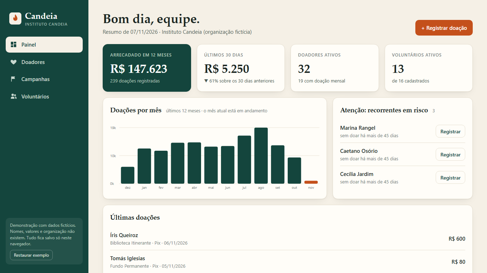
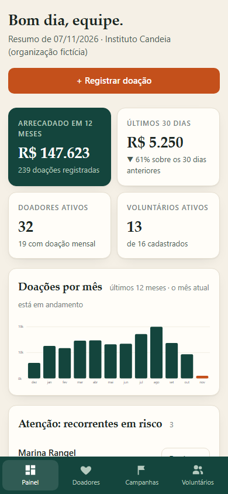
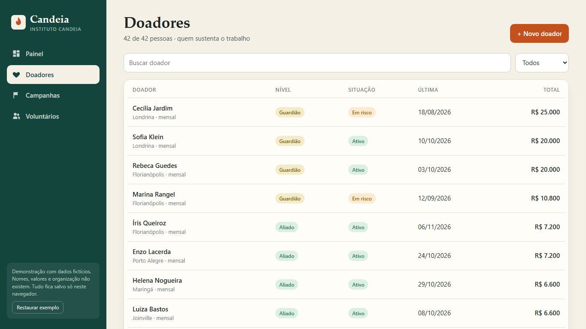

# Candeia — CRM for nonprofits

A fundraising and volunteer CRM for a small NGO: donors, campaigns, donations and volunteer hours in one place.
Built with **Svelte 5 + Vite**. Everything runs in the browser and persists to `localStorage`.

**Live demo:** https://alissonlittig.github.io/candeia-ong-crm/

> All data is fictional. "Instituto Candeia", the people, e-mails and amounts do not exist. Nothing leaves your browser, and the sidebar has a *Restore sample data* button.



| Mobile (390 px) | Donors |
|---|---|
|  |  |

## What it does

- **Dashboard** — 12-month totals, last 30 days vs. the 30 before, 12-month bar chart (SVG), recurring donors at risk of lapsing, latest donations.
- **Donors** — search, filter by tier (Novo / Amigo / Aliado / Guardião), recurring and at-risk views; donor record with history and team notes; register a donation or add a donor.
- **Campaigns** — progress against goal, days left, number of distinct donors.
- **Volunteers** — filter by area, pause/activate, log hours, add volunteers.

Business rules live in `src/lib/logic.js` as pure functions (tiers, "at risk" = recurring donor with no gift in 45+ days, monthly series, form validation) and are covered by `test/logic.test.js`.

## Run it

```bash
npm ci
npm run dev      # http://localhost:5173
npm test         # vitest
npm run build    # static output in dist/
```

CI (`.github/workflows/ci.yml`) runs tests, builds and deploys to GitHub Pages on every push to `main`.

## Notes

- Sample data is generated from a fixed seed, so every visitor sees the same organization.
- Layout is responsive down to 390 px (bottom tab bar on phones, no horizontal scroll) and keyboard accessible.
- Dates are pinned to 2026-11-07 so the demo data never goes stale.


